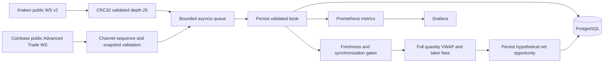

# Phase 1 architecture

## Data flow

## Contracts and ownership

`schemas.py` defines immutable Pydantic v2 models with finite Decimal prices,
quantities, fee fractions and profits; timestamps normalize to UTC. Books require
strict price ordering, unique levels, positive sizes, both sides and an uncrossed
spread. `config.py` validates environment-only configuration. Shared implementation
contracts and initial work ownership are in `INTERFACES.md`.

`adapters/base.py` supplies Decimal JSON decoding, snapshot state, timeout,
protocol ping/pong and reconnect backoff capped at 30 seconds. Cancellation clears
state. Every reset increments a generation and clears synchronized symbols. The
runtime tags queued observations and cached books with this generation so an old
book cannot re-enter detection after resynchronization. A database error propagates
and stops the service; Compose restarts it. Persistence calls and initialization
have a configurable 10-second cooperative asyncio deadline. Queue capacity is 128 observations;
backpressure bounds memory, and delayed observations fail the freshness gate.

## Exchange integrity

Kraken subscribes to WebSocket v2 `book` at depth 25. Absolute level updates and
zero deletions are applied in wire order and truncated to subscribed depth.
Every emitted frame requires CRC32 verification across the top ten asks then bids,
preserving wire Decimal precision. Missing snapshots, invalid/crossed books,
regressing event timestamps and checksum errors reset the entire connection.
Kraken snapshots without an event timestamp use receive time and do not establish
exchange-time ordering for the subsequent update.

Coinbase subscribes without authentication to Advanced Trade `level2` and
`heartbeats`. `l2_data` snapshots establish state; absolute updates replace
quantities and zero deletes levels. Sequence numbers are checked across the entire connection, including subscription
acknowledgements and heartbeats, as observed on the public wire;
gaps, duplicates or reordering invalidate all cached state. The full received
book is reconstructed internally and observations expose only the top 25 levels.
Snapshot observation time uses the envelope timestamp because level timestamps
may be epoch values. All Coinbase observations consistently use the server envelope publication timestamp;
queued engine updates may predate the snapshot publication. Individual engine
timestamps are validated but are not used to regress the observation clock.

WebSocket receive timeout reconnects on silence, and missing initial snapshots
also trigger reconnect. Heartbeats keep the transport active but do not update
book freshness. Valid synchronization does not imply a sufficiently fresh market
observation: both checks are required. Conservative validation can discard
otherwise usable data; Phase 1 favors omission over an unsupported signal.

Official protocol references:

- [Kraken v2 checksum guide](https://docs.kraken.com/exchange/guides/websockets/book-checksum-v2)
- [Coinbase level2](https://docs.cdp.coinbase.com/api-reference/advanced-trade-api/websocket/level2)
- [Coinbase heartbeats](https://docs.cdp.coinbase.com/api-reference/advanced-trade-api/websocket/heartbeats)

## Pricing and persistence

Both venue directions are evaluated for each symbol at configured fixed base
quantity. The engine consumes asks for a hypothetical buy and bids for a sell,
requires sufficient displayed liquidity for each whole leg, and subtracts taker
fees from both notionals. It records only net estimates strictly greater than the
configured nonnegative threshold. Arithmetic uses Decimal precision 50 and never
converts monetary inputs to binary float. Metrics convert aggregates to float
only for operational display.

A book must pass synchronization, generation, nonfuture timestamp, age and
inter-venue event-skew checks. Default maximum age is five seconds and skew two
seconds. Explicit taker fees are required on both venues. This is an opportunity
observer, without inventory accounting, cash reservation, execution or realised
P&L. Repeated observations of unchanged liquidity are distinct research samples.

Alembic creates `book_observations` and `opportunities`. Rows contain indexed UTC
timestamps plus complete canonical JSONB payloads. Pydantic serializes Decimal
as JSON strings, preserving decimal representation without imposing a SQL Numeric
precision bound. Reads must parse those strings as Decimal for financial work.
Market observations are appended without automatic expiry. Book and opportunity
writes use separate transactions, so a failure can leave a book without its signal;
there is no exactly-once or atomic pair guarantee.

On SIGTERM/SIGINT, producers explicitly close their async generators before they
return, invalidating feed state even when cancellation interrupts queue backpressure.
The consumer drains accepted observations for a configurable five-second grace,
then cancels. A grace expiry is logged and counted; this does not promise lossless
shutdown. Generation-invalid observations remain historical persistence records
and are excluded from detection. See the independent review for precise limits.

## Operations and limits

Compose runs PostgreSQL 16, an unprivileged Python 3.12 application, Prometheus
and a provisioned Grafana dashboard. Monitoring configuration is copied into
its images to avoid runtime dependence on host filesystem mounts. Host ports bind
only to loopback. Runtime
Python dependencies are hash locked; image tags are versioned but base image
patches can change. No paid cloud services are used. GitHub Actions reproduces
static checks, migration, deterministic tests and container build on pull requests.

Metrics expose observations, receive ages, synchronized state, resets, integrity
failures, queue depth, persistence latency, readiness and hypothetical signals.
JSON logs label exchange, symbol and error reason. `crossx_ready` reflects database
initialization and a running consumer; feed status and freshness must be checked
separately. Docker restart policy handles process failure, not stale feeds.

Phase 1 does not model capital allocation, GBP/USD, venue balances, realistic fill
latency, slippage beyond displayed depth, opportunity exclusivity, funding,
withdrawals, taxes, settlement or rebalancing. No live execution or credential
extension point exists. Long-duration soak testing and historical profitability
research remain future work.

# Phases 2–7 extension

The Phase 1 data path and integrity algorithms remain. The registry adds Binance market-data-only diff depth plus public REST snapshots, and Crypto.com spot snapshot/delta subscriptions. Four venues share the existing bounded 128-book queue and immediate batched PostgreSQL consumer. Canonical symbols preserve actual quote assets; the USD detector rejects other quotes. `market_id` is optional for legacy payload compatibility.

Separate paper clients stream immutable observations from PostgreSQL through `Simulator`. State consists of at most configured venue/symbol books, visible-level consumption, venue wallets and one pending trade per symbol. Receipt-ordered replay advances simulated leg timers before admitting later data. No adapter receives simulated execution instructions.

Alembic 0002 adds session/config/provenance/results and ordered event evidence, plus a receipt/id replay index. Existing book/opportunity tables and payloads remain valid. Event JSON records allocation, evaluation/rejection, reservation, leg fills and settlements; final results include balances, inventory cost basis, P&L, drawdown, unhedged exposure and assumptions. Checkpoints are transactional and output directories cannot overwrite existing evidence. Destructive migration rollback is intentionally blocked.

The existing storage exporter exposes the latest completed paper-session metrics with fixed labels. This is session-result monitoring, not live exchange account reporting. An opt-in Alertmanager/local webhook sink delivers notifications to local container logs. Default Compose does not enable it. Read-only archive/export and verification supplement the existing retention planner; no automated delete or expiry exists.

See `EXCHANGES.md`, `PAPER_RESEARCH.md`, `FORWARD_EVALUATION.md` and `PHASE2_7_IMPLEMENTATION.md` for contracts, assumptions, operating requirements and acceptance limits.
